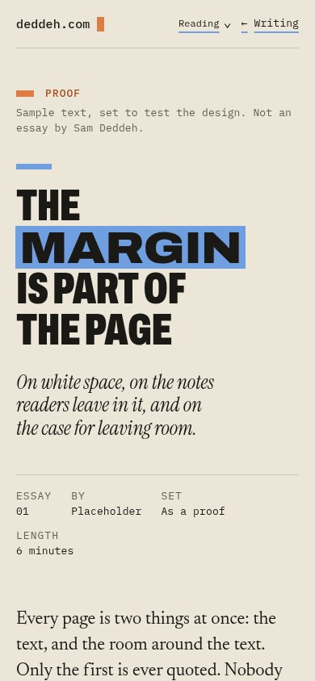
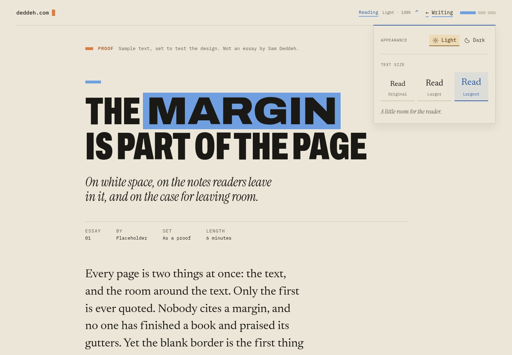
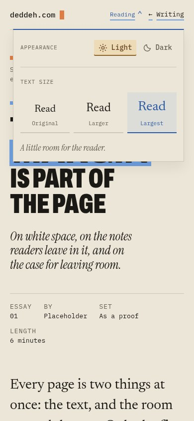
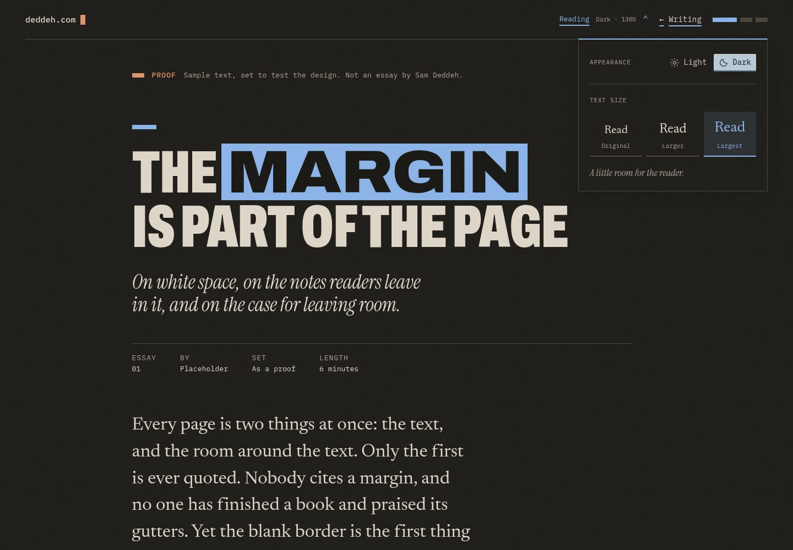
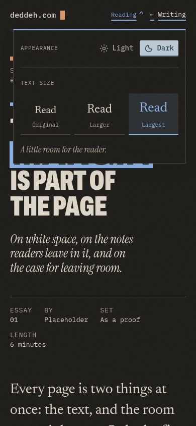
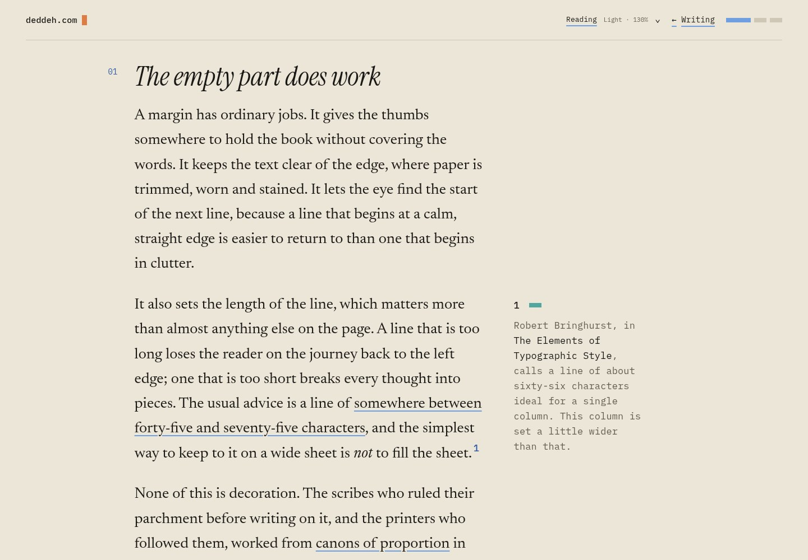
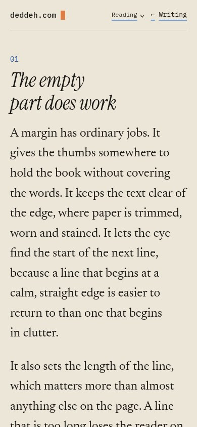
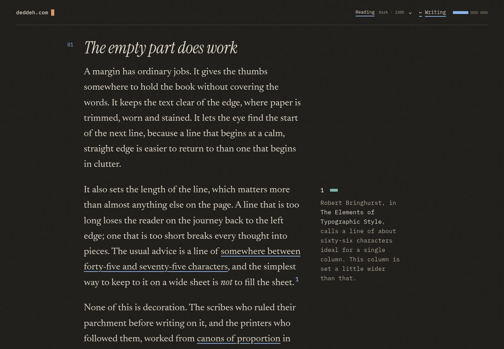
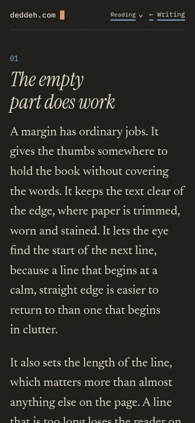

# The art of reading

A small typesetter’s slip gives the reader a place in the composition. **Reading** is an underlined, named control in the running masthead. It opens onto two familiar Light / Dark choices and three specimens of the word *Read*, set at the sizes they represent. Fine rules, the existing blue ink, warm mode swatches and quiet mono labels belong to the article’s visual vocabulary. The slip is not modal; the article remains available behind it.

Original, Larger and Largest are 100%, 115% and 130%. Original retains the exact article composition of PR #14. The body, section headings, pull quotations, note text and superscript references scale together. The title, standfirst, metadata and section numbers remain the page’s furniture. The 620px desktop measure is retained: approximately 67 characters becomes approximately 51, still a comfortable line. On phones the original 19px body becomes 21.85px or 24.7px. Margin notes retain their established placement and fold into the text at the existing breakpoint.

The choice is applied without a layout animation. When already reading, a DOM Range remembers the first visible word and restores its vertical position after reflow. Original is always one explicit choice away; selecting an active choice is harmless. Appearance retains PR #14’s 450ms palette fade and exact colours.

## Interaction and access

- The same named native buttons appear on desktop and mobile. There is no mobile-only icon to decipher. Every target is at least 44px in both dimensions.
- Reading reports its expanded state and current choices. Desktop also shows the current appearance and percentage beside the label. Light / Dark and size buttons expose their selected state.
- Enter or Space opens the slip. Tab traverses Light, Dark, Original, Larger and Largest, then returns to the page. Escape closes and returns focus to Reading. Clicking outside closes; tabbing out does not trap focus. Resizing the viewport does not replace controls or lose focus.
- The slip overlays the page without moving its layout and scrolls internally in short viewports. It uses the article palette and remains reachable in the sticky masthead.
- Only explicit choices write preferences. Existing `deddeh:reading-mode` values remain compatible; size uses `deddeh:reading-size`. Other tabs and restored pages synchronize. Denied storage still allows changes for the current page.
- No JavaScript presents the original light article without dead controls. Print uses the original light composition. Reduced motion changes appearance immediately; text reflow is immediate in all cases.

## Proof and first paint

Vite inlines the shared size reader and applicator beside the existing palette bootstrap in every Writing page, before the article bundle runs. Saved size therefore works on direct loads, future essays and the hidden proof iframe, even if the interactive module fails.

At measurement, the proof refreshes both choices before reading word positions; a prepared iframe can be older than the preference. The payload carries its size as well as its palette and viewport. Arrival rejects a mismatched size instead of drawing stale bars. The Three.js formations, timing, materials, proof-pulling choreography and fallbacks are unchanged.

## Review evidence

The implementation starts at the verified exact head of PR #14, `c55df7b5a2c329c3e0f202601e9abcca08bfb948`, on `design/reading-comfort`. Its PR targets `design/writing-mode-discoverability` so reviewers see only this enhancement. The original branch is untouched; neither PR is merged by this work.

`npm run check`, all 52 unit tests, the standard build and the Pages build pass. `verification.json` records the browser results. The focused reading browser suite also runs in PR validation. `npm run verify:reading` checks the built site at 320, 390, 600, 601, 820, 1100 and 1440px, all sizes, both palettes, touch and keyboard controls, persistence, reading-place retention, measured proof coordinates, Back/Forward and fallbacks. With `BASELINE_URL`, it compares the original article’s geometry and actual pixels below the masthead against PR #14 in both palettes. `npm run verify:pages` covers the wider site with mocked Contact submissions.

Visual review used Linux Chromium, the shared desktop browser and emulated mobile viewports. This is not a physical-device, Safari/Firefox or spoken screen-reader audit.

| Desktop | Mobile |
| --- | --- |
|  |  |
|  |  |
|  |  |
|  |  |
|  |  |

## Run and verify

```sh
npm ci
npm run check
npm test
npm run build:pages
npm run preview -- --port 4178 --strictPort --base=/deddeh.com/
# http://localhost:4178/deddeh.com/writing/the-margin/
```

In another terminal (omit `CHROMIUM_PATH` when using Playwright’s installed browser):

```sh
PREVIEW_URL=http://localhost:4178/deddeh.com/ CHROMIUM_PATH=/usr/bin/chromium npm run verify:reading
PREVIEW_URL=http://localhost:4178/deddeh.com/ CHROMIUM_PATH=/usr/bin/chromium npm run verify:pages
```

For baseline comparison, build the exact PR #14 commit in a separate worktree and serve it at `http://localhost:4179/`. Add `BASELINE_URL=http://localhost:4179/` to the reading verification command. Use built assets for both versions so the baseline’s fonts are served inside its own root.

For a portable interactive preview, run `npm run package:reading-preview`, unzip `artifacts/Deddeh-Reading-Comfort-preview.zip`, then run `python3 preview.py` (Windows: `py preview.py`). Open `http://127.0.0.1:4177/deddeh.com/writing/the-margin/`. The archive contains the full built site, local fonts and the source commit. No production deployment is needed.
