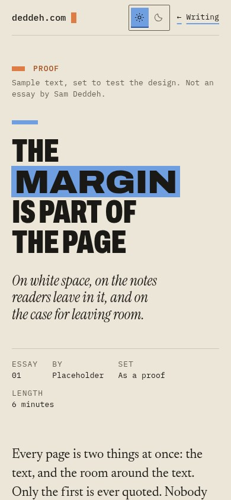
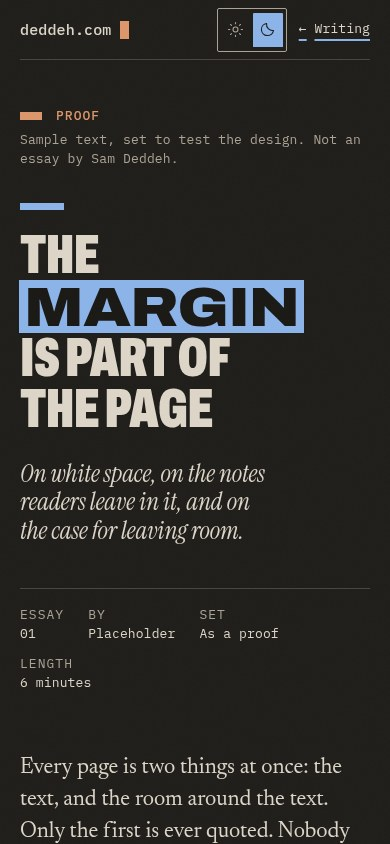
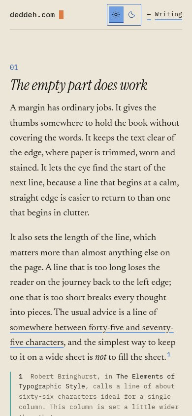

# Writing: Light / Dark, Paper / Ink

Writing has two reading atmospheres: the original ivory Paper and warm charcoal Ink. A framed **sun / Light · moon / Dark** control in the running header makes that choice visible. Its selected half uses the existing blue block, dark lettering and a fine lower rule. IBM Plex Mono, small line icons and nearly square corners keep it close to the site's editorial vocabulary.

The original Paper / Ink words looked like a quiet header annotation. Familiar symbols, literal Light / Dark labels, a visible boundary and a filled selection now identify the control as interactive. This is a design judgment, not a claim established by automated tests or a first-time-user study.

At 600px and below, the words drop away and both sun and moon remain in a **70 × 44px** button. It occupies the same header slot without an extra row; Writing and home retain their own targets. The full control is one native toggle: clicking or tapping anywhere changes modes. Its stable accessible name is **Dark reading mode** and `aria-pressed` announces on/off. Enter and Space work, icons are decorative to assistive technology, and a separate blue focus outline remains visible.

## Scope and provenance

- GitHub account/repository authenticated as `module7543` / `module7543/deddeh.com`.
- Fresh branch `design/writing-mode-discoverability` starts directly at PR #12's verified head, `a63fe70578b3b993985ef5f210ef16114343f6e1`.
- Production `main` had advanced to `639d75c8f70f31742743438d266a8bd2c9800b6d`. Its only additional change was `.github/workflows/pr-checks.yml`; it was inspected and merged into this branch.
- The new PR targets `main` and contains the complete reading-mode feature. It does not depend on merging PR #12. Both PRs remain unmerged; PR #12's branch is unchanged.
- Refinement runtime changes are confined to the control markup/name/title in `src/reading-mode.js` and its styles in `src/article.css`. Palettes, article typography/layout, the 450ms fade, persistence, proof-pulling animation, scroll/focus handling, reduced motion and print behavior remain as implemented in PR #12. No refinement changes to homepage, Apps, Music or Contact code.

## Complete reading-mode implementation

- `src/reading-palette.css` owns the semantic article colors. Ink uses warm charcoal `#201e1b`, text `#dcd5c7` and secondary text `#aaa293`. Print uses light Paper.
- Vite injects the palette and shared preference bootstrap into every `writing/*/index.html` head. Explicit `deddeh:reading-mode` preference applies before first paint; future Writing articles share the implementation.
- `src/reading-mode.js` creates the control, persists explicit choices and synchronizes tabs and restored history entries. No JavaScript means readable Paper with no dead control. Denied storage still allows switching.
- The existing proof measures the chosen surface and shadow colors. Its geometry, formation, easing and timing stay intact; measured and fallback entries respect the saved mode.
- Registered CSS color properties keep the background and text fade synchronized. Reduced motion switches immediately.

## Verification

The current refinement was tested in Linux Chromium with software WebGL and emulated mobile touch. The original PR #12 build was served separately as the comparison baseline.

- `npm run check`; `npm test`: **44 tests passed**; `npm run build`; `npm run build:pages`.
- Existing `verify:pages` passed desktop and mobile navigation, Writing, Apps, Music playback and mocked Contact. No real Formspree submissions.
- `verify:reading`: pointer, Enter/Space and emulated touch; switching in both directions; native accessibility name/pressed state; visible focus; 44px target; unchanged scroll, focus and article geometry; reload, another article fixture and cross-tab persistence; sticky header and no navigation overlap at 320, 360, 390, 600, 601, 768, 1100 and 1440px.
- The Paper article geometry and opening pixels below the proof label match PR #12 exactly at desktop and mobile sizes. Palette/proof source files are unchanged by the refinement.
- The reading suite also checks first-frame Ink with delayed/failed modules, measured proof and stale iframe preference, fallback entry, Back/Forward restoration, reduced motion, denied storage, no JavaScript and light print during a switch.
- Control label/icon contrast is checked against each actual selected/unselected surface; boundary and focus contrast are checked separately. [Measured results](verification.json).
- Shared Chromium desktop inspection covered both directions, the scrolled sticky dark header and keyboard focus. Actual screenshots below were inspected at desktop, 390px and 320px widths.
- An inherited fallback check raced the outgoing page navigation. The test now holds the destination request until the outgoing fallback palette has been inspected; application behavior is unchanged.

Limits: no physical iOS/Android device, Safari/Firefox or spoken VoiceOver/NVDA audit. Native accessibility-tree, keyboard, touch emulation and contrast checks do not establish spoken screen-reader behavior or aesthetic quality. Cross-article testing uses a local second-article fixture because only one essay is published. No production deployment was made.

## Run the exact reviewed commit

Use the new PR's head SHA (also recorded in the portable preview's `START-HERE.txt`):

```sh
git fetch origin design/writing-mode-discoverability
git switch --detach <new-PR-head-SHA>
npm ci
npm run build:pages
npm run preview -- --base=/deddeh.com/ --port 4175
# http://localhost:4175/deddeh.com/writing/the-margin/
```

Then, in another terminal:

```sh
CHROMIUM_PATH=/usr/bin/chromium PREVIEW_URL=http://localhost:4175/deddeh.com/ npm run verify:pages
CHROMIUM_PATH=/usr/bin/chromium PREVIEW_URL=http://localhost:4175/deddeh.com/ npm run verify:reading
```

Omit `CHROMIUM_PATH` to use Playwright's installed Chromium. Set `BASELINE_URL` to a separately served reference build to repeat the geometry/pixel comparison. The reading verification regenerates screenshots here and writes its report/print PDF under `artifacts/reading/`.

For a portable preview: run `npm run package:reading-preview`, unzip `artifacts/Deddeh-Paper-Ink-preview.zip`, then run `python3 preview.py` (Windows: `py preview.py`). It serves the complete bundled website with local fonts/audio and records its exact source commit. Contact retains its real destination; do not send test messages. The preview is local; no public branch-preview host or port-forward tool was available in this environment.

## Actual screenshots

Chromium captures, with matched positions within each pair. Light uses Paper; Dark uses Ink.

| Position | Light | Dark |
|---|---|---|
| Desktop 1440 × 900, opening |  |  |
| Desktop, reading |  |  |
| Mobile 390 × 844, opening |  |  |
| Mobile, reading |  |  |
| Mobile 320 × 844, opening |  |  |

`paper-ink.mp4` is historical footage from PR #12, showing the original text control; the screenshots above show the current refinement.
