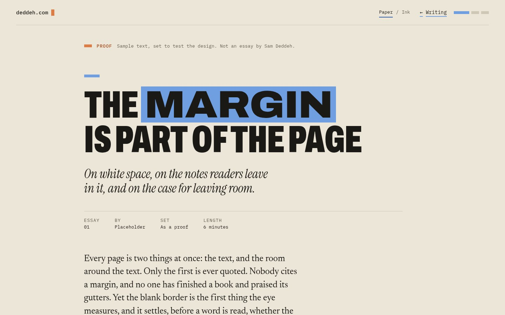
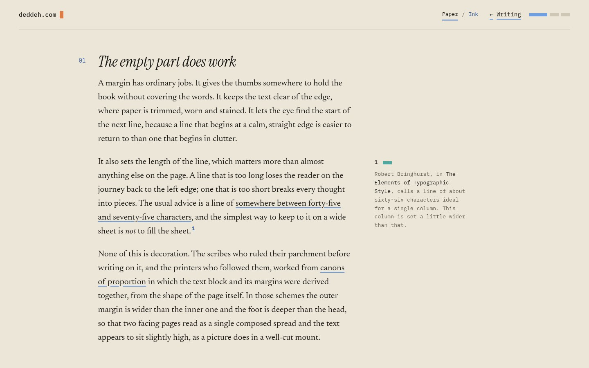
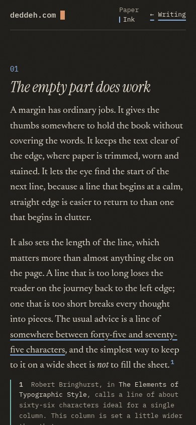

# One article, two atmospheres

Paper / Ink adds an evening reading surface to Writing's existing editorial proof. Paper retains its ivory ground, typography, asymmetric measure and marginalia. Ink uses warm charcoal (`#201e1b`), softly luminous text (`#dcd5c7`) and quieter secondary text (`#aaa293`). The blue title block retains dark lettering; blue, orange and teal stay recognizably part of the same composition.

The control is a small IBM Plex Mono button in the existing header. A blue rule identifies the current mode, horizontally on desktop and vertically beside the two-line label on phones. The running header stays available through the article; it adds no new row, floating panel or change to the article's dimensions. On narrow screens the control occupies the decorative header marks' space. Its native button semantics announce **Ink reading mode, pressed/not pressed**; Space, Enter, touch and pointer all operate the same 44px-or-larger target.

A 450ms fade interpolates shared registered CSS color properties once, keeping inherited text and links synchronized. Reduced motion is immediate; browsers without registered custom property support retain an immediate usable switch. There are no new runtime dependencies.

## Shared implementation

- `src/reading-palette.css` owns the semantic article colors. Only `.paper` pages receive them. Ink's overrides are screen-only, so print always uses a light sheet.
- Vite injects that palette and the shared preference bootstrap into every `writing/*/index.html` head. The explicit `deddeh:reading-mode` preference is applied before the article module, fonts or first visible content; future articles require no separate theme implementation. No system-clock or OS-theme inference is used.
- `src/reading-mode.js` progressively creates the control, stores explicit choices, and synchronizes other tabs and restored history entries. Storage denial still permits switching on the current page. No JavaScript means readable Paper and ordinary navigation, with no dead control.
- `src/proof.js` retains the typography measurement algorithm. It refreshes a prepared iframe's preference at measurement time, samples the actual surface and rules, and blends word bars against that surface. `Field.proof` accepts those two colors; geometry, formation, easing and timing remain the existing implementation.
- The homepage's proof-only CSS uses the same palette for its header and fallback fade. Unmeasured and no-WebGL entries also land in the chosen atmosphere. Arrival bars carry their mode, preventing a stale palette from drawing over another mode.
- Return links and browser Back/Forward retain the existing navigation. Only the proof method's color arguments change in `field.js`; homepage artwork and Music sculpture generation are untouched. Article copy/metadata, Contact, deployment and domain configuration are unchanged.

## Verification

Verified against production `main` at `0bba93a64cc4c24d41f2da96ab58e36e686e5d51`.

- JavaScript syntax check; **44 interaction/unit tests**, including seven preference tests; GitHub Pages production build.
- Existing site-wide Chromium verification on desktop and mobile: Writing, Apps, Music playback, navigation and mocked Formspree. No real submissions.
- `verify:reading`: default Paper despite OS dark preference; both directions of switching; Enter/Space/touch; native accessibility-tree state; unchanged focus, scroll and typesetting; reload and a second article fixture; direct saved-Ink entry with delayed and failed module downloads; real measured proof in both modes; a previously prepared iframe with a changed preference; no-WebGL/unmeasured fallbacks; return navigation; actual Back/Forward cache restoration in both modes; cross-tab synchronization; reduced motion; widths 320, 360, 390, 600, 768, 1100 and 1440; denied local/session storage; no JavaScript; print during a switch and return to Ink on screen.
- First-frame sampling found no Paper background with stored Ink, even with the article bundle delayed or aborted.
- Desktop and mobile article geometry and typography match production. Paper's opening pixels below the proof label are identical. The existing orange Proof label received a minimal AA correction (`#a84f1e` → `#a64e1e`, 4.44:1 → 4.52:1); the unused teal text token was also strengthened for future use.
- Text contrast: Paper body 14.10:1, secondary 5.17:1; Ink body 11.39:1, secondary 6.57:1. Tested links, highlighted title, section numbers, notes, captions, control focus, hover and selection. [Measured ratios and history evidence](verification.json).
- Hands-on shared Chromium inspection: switching, scrolling, return navigation and saved-Ink fallback entry. Reviewed all eight captures and a rendered print PDF. [Rendered browser recording](paper-ink.mp4) includes both directions, mid-article switching and measured proof entry.

Limits: Chromium on Linux, software WebGL and emulated mobile touch. No physical iOS/Android device, Safari/Firefox or spoken VoiceOver/NVDA audit. Accessibility was checked through native roles/state, the browser accessibility tree, keyboard behavior and contrast. The only published essay is the sample; cross-article persistence uses a locally served second-article fixture. No production deployment was made.

Reproduce against a local Pages build:

```sh
npm ci
npm run check
npm test
npm run build:pages
npm run preview -- --base=/deddeh.com/ --port 4175
# In another terminal:
PREVIEW_URL=http://localhost:4175/deddeh.com/ npm run verify:pages
PREVIEW_URL=http://localhost:4175/deddeh.com/ npm run verify:reading
```

Set `CHROMIUM_PATH` if using an installed Chromium instead of Playwright's browser. Set `BASELINE_URL` to a separately served production build to also run the geometry/pixel comparison. Browser verification regenerates these screenshots; the print PDF and JSON report go to `artifacts/reading/`.

## Interactive preview

```sh
git fetch origin feature/writing-reader-mode
git switch feature/writing-reader-mode
npm ci
npm run dev
# http://localhost:4173/writing/the-margin/
```

For a portable preview with no Node installation: run `npm run package:reading-preview`, unzip `artifacts/Deddeh-Paper-Ink-preview.zip`, then run `python3 preview.py` (Windows: `py preview.py`) inside the extracted folder. It opens the complete built website on a local-only server, with the source commit recorded in `START-HERE.txt`. Test the toggle, reload, return to Writing and reopen the article. Contact retains its real destination; do not send test messages.

## Comparable screenshots

Actual Chromium captures at 1440×900 and 390×844. Each opening and reading pair uses the same scroll position.

| Position | Paper | Ink |
|---|---|---|
| Desktop opening |  |  |
| Desktop reading |  |  |
| Mobile opening |  |  |
| Mobile reading |  |  |
