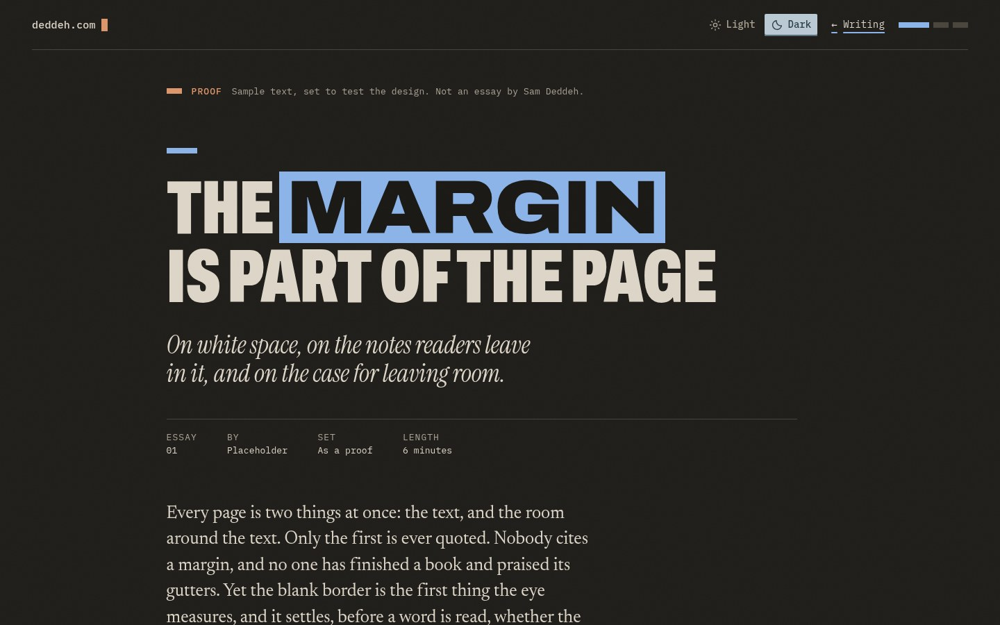
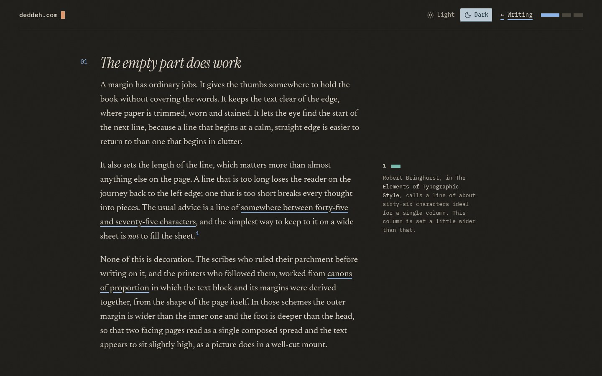
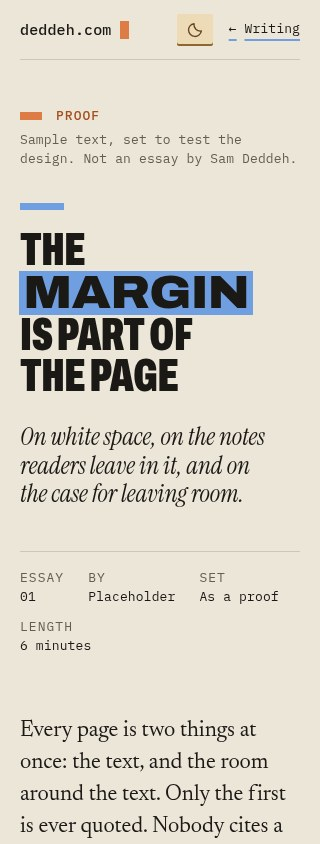
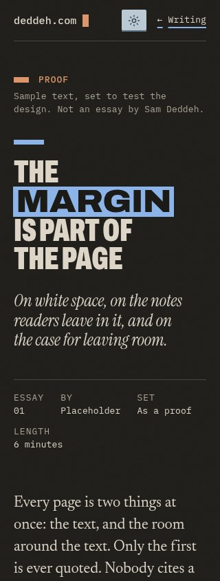

# Writing: Light / Dark control

Writing retains its ivory Paper and warm charcoal Ink reading atmospheres. The final control refinement removes the outer frame and gives **Light** and **Dark** independent native buttons. Selecting the active option keeps the mode and fade unchanged. The selected face is a small printing block inside a full-height touch target: pale amber for Light (`#eddbb8`), moonlight blue-gray for Dark (`#b9c8d2`), each with dark lettering and a fine lower rule. The article palettes are unchanged.

IBM Plex Mono labels increase from 13px regular to 14px medium. Icons increase from 17px / 1.5-unit strokes to 18px / 1.8-unit strokes. The inactive option sits directly on the page and gains a quiet fill on hover. The restrained blocks, nearly square corners and baseline rules borrow from the site's existing typography and accents.

At **600px and below**, one **44 × 44px** appearance button leaves comfortable space for the site identity and Writing return link, including at 320px. Its moon means “Switch to dark reading mode”; its sun means “Switch to light reading mode.” Both its accessible name and title name that action. The fill reflects the current atmosphere. It does not present two apparent options sharing one hit region.

## Interaction and accessibility

- Desktop: native Light and Dark buttons in a named “Reading appearance” group, each with `aria-pressed`. Tab / Shift+Tab visit each option; Enter and Space select it. Both options remain available, including the selected one. This is a button group, with native button keyboard behavior.
- Desktop targets measure **85 × 44px** and **76.61 × 44px**, separated by 4px. Mobile has one **44 × 44px** target. No nested buttons, overlapping targets or hidden tab stops.
- Icons are decorative to assistive technology. The mobile button uses an action name rather than a pressed state. CSS exposes only the appropriate desktop/mobile controls.
- Selection retains focus and scroll position. Resizing across the breakpoint transfers focus to the visible equivalent only when a control already had focus.
- An explicit selection persists even when it matches the default. Reselecting the active option neither starts nor extends the fade. No automatic time-of-day or OS-driven switching.
- Selected label/icon contrast: **6.34:1 Light**, **6.69:1 Dark**. Inactive labels: **5.17:1 Light**, **6.57:1 Dark**. The selected lower rules and keyboard outlines exceed **3:1** against their adjacent surfaces. Hover contrast also passes. [Measured evidence](verification.json).

## Scope and provenance

The authenticated repository is `module7543/deddeh.com`, PR **#14**, branch `design/writing-mode-discoverability`. Before any edits, both the GitHub API and fetched Git revision matched the owner's reviewed head **`d4235ec7edcff3c781da81001979f805cc792af7`**. This update appends to that history. PR #12 is untouched; neither PR is merged.

Runtime edits are confined to `src/reading-mode.js` and the control-specific rules in `src/article.css`. The original article palettes, typography, content, layout, proof animation, 450ms fade, storage key, history restoration and print styling remain intact. No other website section, dependency or font-size control was added or changed.

PR #14 still contains the complete reading-atmosphere feature inherited from PR #12's `a63fe70578b3b993985ef5f210ef16114343f6e1`, plus the existing merge of main's PR-validation workflow. It does not require merging PR #12 first.

## Verification

- `npm run check`; `npm test`: **47 passed**; `npm run build`; `npm run build:pages`.
- `verify:pages`: desktop and mobile navigation, Writing and return, Apps, Music playback, mocked Contact, keyboard interactions, assets and no overflow. No real Contact submissions.
- `verify:reading`: independently select Light and Dark by pointer, touch, Enter and Space; reselect each active option; inspect accessibility state, focus outlines, tab order, target dimensions and header separation.
- Mobile 320px and 390px plus 360, 600, 601, 768, 1100 and 1440px: both directions, no overlap/overflow, compact action names, keyboard focus and reduced motion. The 600/601px resize check also verifies focus retention.
- Both modes preserve article geometry and opening pixels below the proof label compared with a separate build of `d4235ec7…`, on desktop and mobile.
- Reload, second-article fixture, live cross-tab synchronization, measured proof entry, stale iframe preference, fallback entry and Back/Forward restoration all pass.
- The fallback verification samples its palette at the class change, avoiding a browser evaluation blocked behind pending navigation. Application navigation is unchanged.
- Cold saved-Ink paint with delayed/failed modules; denied storage; no JavaScript; and light print during a switch all pass.
- Shared Chromium inspection verified independent and repeated selection, keyboard focus, and the scrolled sticky header. The actual desktop, 390px and 320px screenshots below were visually inspected.

Limits: Linux Chromium with emulated touch; no physical phone, Safari/Firefox or spoken screen-reader audit. The second article is a local test fixture because only one essay is published. Automated checks establish behavior and measurements, not first-time-user discoverability.

## Exact-commit preview

The PR description records the final full SHA. Check out that revision to reproduce the preview:

```sh
git fetch origin design/writing-mode-discoverability
git switch --detach <PR-head-SHA>
npm ci
npm run build:pages
npm run preview -- --base=/deddeh.com/ --port 4175
# http://localhost:4175/deddeh.com/writing/the-margin/
```

In another terminal:

```sh
CHROMIUM_PATH=/usr/bin/chromium PREVIEW_URL=http://localhost:4175/deddeh.com/ npm run verify:pages
CHROMIUM_PATH=/usr/bin/chromium PREVIEW_URL=http://localhost:4175/deddeh.com/ npm run verify:reading
```

Omit `CHROMIUM_PATH` to use Playwright's installed Chromium. Set `BASELINE_URL` to a separately served build of `d4235ec7…` to repeat the geometry/pixel comparison. The reading suite regenerates the screenshots and writes `artifacts/reading/report.json` and a print PDF.

For a portable preview, run `npm run package:reading-preview`, unzip `artifacts/Deddeh-Paper-Ink-preview.zip`, and run `python3 preview.py` (Windows: `py preview.py`). Open **http://127.0.0.1:4177/deddeh.com/writing/the-margin/**. `START-HERE.txt` records the exact source commit. The complete build includes local fonts and audio. Contact retains its real endpoint; do not send test messages. No public branch-preview host or port-forwarding tool was available, and production hosting was not changed.

## Actual browser screenshots

Matched viewport and reading positions within each pair. Light uses Paper; Dark uses Ink.

| Position | Light | Dark |
|---|---|---|
| Desktop 1440 × 900, opening |  |  |
| Desktop, reading |  |  |
| Mobile 390 × 844, opening |  |  |
| Mobile, reading |  |  |
| Mobile 320 × 844, opening |  |  |

`paper-ink.mp4` is historical PR #12 footage with the original text control. The screenshots above show the final refinement.
